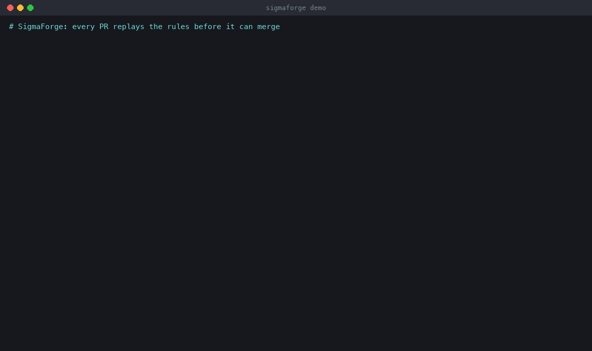
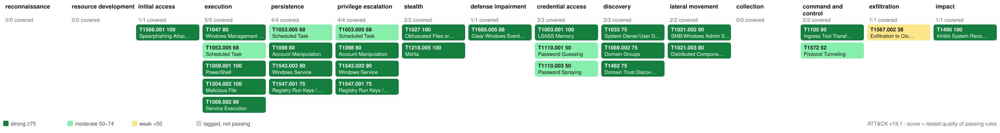

# SigmaForge

**Detection-as-code for Sigma rules: every pull request proves the rule fires on attack
telemetry, stays inside a noise budget on benign data, converts correctly to Splunk,
Elastic and Defender XDR, and earns its place on the ATT&CK map. A rule that stops firing
or starts flooding cannot be merged.**

[](https://github.com/sahilsinghi/sigmaforge/actions/workflows/detections.yml)






*Coverage map built from test results, not tags: a technique is coloured only when a rule
for it passes every test, and the score is the rule's earned quality. Full report:
[GitHub Pages](https://sahilsinghi.github.io/sigmaforge/) or the `sigmaforge-report` CI artifact
(HTML report, ATT&CK Navigator layer, every converted query).*

---

## What happens on every pull request

```
rules/*.yml ─► lint ─► pySigma convert ─► Splunk SPL · Elastic Lucene · ES|QL · Defender KQL
                │
tests/positive ─┼─► replay engine ─► every labelled attack event must fire          (TPR)
EVTX samples  ──┼─► replay engine ─► real public attack telemetry must fire         (pinned commit)
tests/negative ─┼─► replay engine ─► near-miss events must NOT fire                 (FP)
tests/benign  ──┴─► replay engine ─► alerts / host / day ≤ the rule's noise budget  (noise)
converted queries ─► SPL / Lucene / KQL evaluators + real OpenSearch ─► same hits as Sigma?
all results ─► quality score ─► ATT&CK Navigator layer + HTML report ─► gate vs main ─► PR comment
```

The gate blocks the merge when any rule fails, when a rule that passed on `main` regresses,
when a technique `main` covered is no longer covered, when a backend that could express a
rule no longer can, or when a converted query disagrees with the Sigma rule for an
undocumented reason. See it happen in **[the example PR](docs/example-pr.md)**: a
"simplified" rule that still passes its positives is blocked for firing on near-miss
negatives and for producing 1.79 alerts/host/day against a 0.05 budget, then a typo is
blocked for dropping the TPR to 0% and losing T1059.001 from the map.

## Results on the current rule set

| | |
|---|---|
| Rules | **23** (20 alerting, 3 correlation building blocks), all passing |
| Tactics / techniques | **12** ATT&CK v19.1 tactics, **24** techniques with a tested, passing rule |
| Labelled positives | **69** attack events and scenarios, **100%** TPR |
| Real attack telemetry | **28/28** EVTX-ATTACK-SAMPLES files fire as expected (pinned, hash-verified) |
| Near-miss negatives | **65** events and scenarios, **0** false positives |
| Benign baseline | **58,391** events, 12 hosts, **168 host-days**; noisiest alerting rule at 0.024 alerts/host/day |
| Cross-backend parity | **61** rule×backend pairs identical, **6** documented differences, **0** undocumented |
| Real OpenSearch | **36/36** Lucene queries return exactly the modelled hit set |
| Pipeline runtime | ~30 s for everything above (unit tests: 59 in ~60 s) |

| Rule | ATT&CK | TPR | Real samples | Noise / budget | Quality |
|---|---|---|---|---|---|
| Encoded PowerShell command | T1059.001, T1027 | 4/4 | 1/1 | 0.000 / 0.05 | 1.00 |
| Certutil download | T1105 | 3/3 | 1/1 | 0.000 / 0.02 | 0.90 |
| LSASS dump via comsvcs MiniDump | T1003.001 | 3/3 | 1/1 | 0.000 / 0.01 | 0.90 |
| Suspicious process opened LSASS | T1003.001 | 4/4 | 3/3 | 0.012 / 0.05 | 1.00 |
| Run key → user-writable path | T1547.001 | 4/4 | 4/4 | 0.012 / 0.15 | 0.75 |
| Scheduled task with suspicious action | T1053.005 | 3/3 | 3/3 | 0.000 / 0.05 | 0.68 |
| Shadow copy / backup catalog deletion | T1490 | 5/5 | 1/1 | 0.000 / 0.01 | 1.00 |
| Event log cleared (CLI) | T1685.005 | 3/3 | — | 0.000 / 0.01 | 0.60 |
| Security log cleared (1102) | T1685.005 | 1/1 | 1/1 | 0.000 / 0.01 | 0.70 |
| Privileged group / trust recon | T1069.002, T1482, T1033 | 6/6 | 2/2 | 0.006 / 0.1 | 0.75 |
| Office spawned a shell | T1566.001, T1204.002 | 4/4 | 1/1 | 0.006 / 0.05 | 1.00 |
| Mshta remote / staged HTA | T1218.005 | 4/4 | 4/4 | 0.000 / 0.02 | 1.00 |
| PsExec pipes (incl. renamed) | T1569.002, T1021.002 | 3/3 | 2/2 | 0.024 / 0.05 | 0.90 |
| Service runs a shell (7045) | T1543.003, T1569.002 | 3/3 | 1/1 | 0.000 / 0.02 | 0.90 |
| Member added to local Administrators | T1098 | 2/2 | 1/1 | 0.006 / 0.05 | 0.80 |
| DNS for reverse-tunnel services | T1572 | 4/4 | — | 0.006 / 0.2 | 0.53 |
| Rclone to file-sharing remote | T1567.002 | 2/2 | — | 0.000 / 0.02 | 0.38 |
| Impacket wmiexec / dcomexec | T1047, T1021.003 | 2/2 | 2/2 | 0.000 / 0.01 | 0.80 |
| Brute force then success (correlation) | T1110.001 | 2/2 scenarios | — | 0.000 / 0.02 | 0.50 |
| Password spray (correlation) | T1110.003 | 2/2 scenarios | — | 0.000 / 0.02 | 0.50 |

How these numbers are defined, and where they stop being trustworthy:
**[How I measure detection quality](docs/measuring-detection-quality.md)**.

## What it found

Replaying converted queries and real telemetry turned up problems that a "does the YAML
parse" pipeline never would. Details and evidence: **[docs/findings.md](docs/findings.md)**.

* **Stock Elastic conversion is case-sensitive.** pySigma's `ecs_windows` pipeline queries
  `process.command_line`, `registry.path` and `winlog.event_data.*` as case-sensitive keywords,
  so Lucene missed `-ENC`, `SCHTASKS /Create` and `HKLM\SOFTWARE\...` (15 events, 7 of them
  real samples) that the Sigma rules catch. Fixed with a custom pySigma transformation
  plus an index template (`sigmaforge export elastic-template`). Verified in OpenSearch.
* **The Defender XDR pipeline emits `RegistryKey endswith "...\Run*"`.** KQL has no wildcards
  there, so the Run-key rule could never match in Defender. Documented and pinned.
* **Real samples pad LSASS access masks** (`0x00001010`), so a rule written with `0x1010`
  matches none of them.
* **Splunk correlations use fixed `bin` buckets.** A password spray straddling 14:00 is missed
  by the converted SPL but caught by the sliding-window engine.
* **ATT&CK v19** renamed Defense Evasion to Stealth and moved log clearing to T1685.005; lint
  checks tags against the live ATT&CK feed.

## Quick start

```bash
python3.12 -m venv .venv && . .venv/bin/activate
pip install -e ".[dev]"

sigmaforge datasets fetch          # the 25 pinned EVTX-ATTACK-SAMPLES files the rules use (~6 MB)
sigmaforge test                    # TPR, real samples, near-miss FPs, alerts/host/day
sigmaforge ci                      # + conversion, equivalence, gate, report -> out/report.html
```

With a local OpenSearch the Lucene queries are also executed for real:

```bash
docker run -d -p 9200:9200 -e discovery.type=single-node -e DISABLE_SECURITY_PLUGIN=true \
  -e DISABLE_INSTALL_DEMO_CONFIG=true opensearchproject/opensearch:2.19.1
sigmaforge ci --opensearch http://localhost:9200
```

| Command | What it does |
|---|---|
| `sigmaforge lint` | `sigma check` + repository rules (metadata, test files exist, wildcard-only values, negation-only conditions, Lucene-incompatible regex, ATT&CK v19 tags) |
| `sigmaforge convert [--show RULE]` | SPL, Lucene, ES|QL and KQL for every rule → `out/queries/` |
| `sigmaforge test` | replay against positives, real samples, negatives and the benign baseline |
| `sigmaforge equivalence [--opensearch URL]` | replay every converted query and compare hit sets |
| `sigmaforge ci` | all of the above + merge gate + HTML report + PR comment + badges |
| `sigmaforge coverage` | ATT&CK table + Navigator layer (`out/attack-navigator-layer.json`) |
| `sigmaforge tune RULE` | which field values cause benign hits; proposes exclusions that keep every positive firing |
| `sigmaforge drift --benign DIR` | nightly noise check on fresh benign data |
| `sigmaforge export elastic\|elastic-template\|splunk` | Kibana detection-rule NDJSON, the `.caseless` component template, `savedsearches.conf` |
| `sigmaforge baseline generate\|lock\|verify\|update` | synthetic benign corpus and the committed regression baseline |

## Repository layout

```
rules/windows/...                 Sigma rules (+ x_sigmaforge test metadata)
tests/positive/<rule>/*.jsonl     labelled attack events (must fire)
tests/negative/<rule>/*.jsonl     near-miss events (must not fire)
tests/benign/                     benign baseline (synthetic generated in CI; real exports go in real/)
datasets/*.lock.json              pinned public datasets: commit + Git blob SHA per file
baseline/metrics.json             last-known-good results on main (regression gate)
baseline/corpus.lock.json         hash of the deterministic benign corpus
equivalence-exceptions.yml        documented, size-pinned backend differences
sigmaforge/                       the pipeline (engine, correlations, lint, convert, evaluators, gate, report)
.github/workflows/                PR gate (+ OpenSearch service), nightly drift, deploy-on-merge
docs/                             methodology, findings, example PR, adding a rule
scripts/                          demo_pr.py, record_demo.py (GIF), Export-SysmonBaseline.ps1
```

## Design notes

* **The replay engine reuses pySigma's parser.** pySigma resolves modifiers (`windash`,
  `base64offset`, `all`, `cidr` ...) and conditions (`1 of selection_*`) into a tree; the
  engine only evaluates that tree. A disagreement between the engine and a converted query
  is therefore a backend or field-mapping difference, not a parsing difference.
* **Backends are judged on the data they would really store.** Events are reshaped into
  Splunk Sysmon add-on fields, Winlogbeat ECS documents and Defender XDR tables (with XDR's
  `HKEY_LOCAL_MACHINE` spelling and `RegistryValueSet` vocabulary). A unit test re-derives the
  field mappings from the live pySigma pipelines, so a pySigma upgrade cannot quietly
  invalidate the shapers.
* **The evaluators are oracles, not SIEMs.** They implement exactly the subset pySigma emits,
  with each engine's semantics: Splunk's NOT > OR > AND precedence, Lucene's implicit regex
  anchoring and `.caseless` normalisers, KQL's wildcard-free `endswith`. Anything else is
  reported as "not evaluable", never guessed. The Lucene model is checked against real
  OpenSearch in every CI run.
* **Time is relative.** Correlation windows use event timestamps only, so a 2019 EVTX sample
  replays exactly like live data.
* **Third-party data stays out of Git.** EVTX-ATTACK-SAMPLES (GPL-3.0) is fetched at test
  time from a pinned commit and every file is checked against its Git blob SHA. The
  synthetic baseline is regenerated in CI and its hash is locked.

## Limits

The benign baseline is a seeded simulation of a small office, not a production network:
treat alerts/host/day as a regression signal until you drop a real lab export into
`tests/benign/real/` (`scripts/Export-SysmonBaseline.ps1`). Public attack samples are biased
toward loud tools. The SPL and KQL evaluators are models checked by unit tests, not by live
Splunk or Defender. 24 tested techniques is a small slice of ATT&CK, and the map says so.
More in [the methodology write-up](docs/measuring-detection-quality.md#limits--read-these-before-quoting-any-number).

## Security

Pull requests are treated as untrusted code: the PR job has a read-only token and no persisted
credentials, secrets exist only in the main-only deploy job, and every action is pinned to a commit
SHA. Details and the one known dependency advisory (pySigma's `diskcache`) are in
[SECURITY.md](SECURITY.md).

## Licence

MIT. Rules and tooling are original work. EVTX-ATTACK-SAMPLES by
[@sbousseaden](https://github.com/sbousseaden/EVTX-ATTACK-SAMPLES) (GPL-3.0) is downloaded at
test time and not redistributed.
